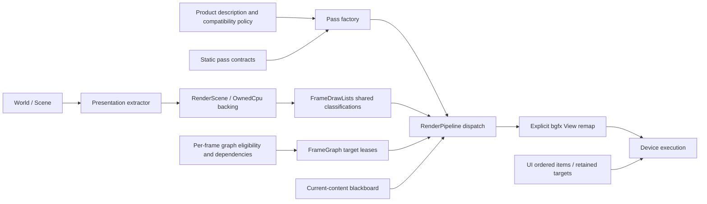

# AYRenderer 当前架构

**Version:** 1.2.2
**Date:** 2026-10-22
**Status:** Active
**Owner:** AYRenderer

本文是模块当前结构入口。历史切片和当时验收保留在 [R6 记录](render-architecture-r6.md)、
[执行计划](execution-plan.md)及各 Pass 专题；后续提案见
[根渲染路线](../../../AYDocs/AYRendering-Architecture-Roadmap.md)和
[源码自审](../../../AYDocs/RENDERER-ARCHITECTURE-AUDIT-20261022.md)。历史的阶段禁令不替代本页现状。

## 1. 使用入口与职责

游戏侧按 Agent SDK 通过 Entity 组件、World 相机/灯光和已安装的渲染集成提取。
`Renderer`、`RenderPipelineDesc` 的直接操作属于高级 Host/工具集成。
Pass 工厂、FrameGraph、bgfx 句柄及资源表是内部结构，不作为新增游戏 API 推荐。

| 层 | 负责 | 不负责 |
|---|---|---|
| RendererSubSystem | Presentation 提取、World 相机覆盖、Scene/UI 复合入口 | 游戏规则、离线转换 |
| RenderScene | 同步提交包、可选 OwnedCpu backing、SceneLights 值快照 | GPU 驻留租约、设备调度 |
| RenderPipelineDesc / Policy | 产品默认槽位、Editor 覆盖槽、旧描述的 Present 兼容边界 | GPU 分配、Pass 执行 |
| RenderPipelineFactory | 每槽新建独立 Pass 实例，未知槽拒绝 | 默认产品选择、资源准备 |
| Renderer::Impl | 设备生命周期、实际功能资格、帧装配、主/预览/多视图入口 | 重新解析一套资源格式 |
| RenderPipeline | 持有 Pass、按顺序 dispatch、记录结果 | 产品列表、设备 View 分配 |
| 静态合约 / 图计划 / 黑板 | 分别验证装配、声明逐帧依赖、记录当前内容有效性 | 把有效 handle 当成已写内容 |
| RRM / 资源桥 | L2 到 L3 转换、路径缓存、稳定 ID、失败重载保留 | CPU 文件发布事务 |
| AYShader / BGFXAdapter | 程序与绑定；设备、上传和提交封装 | ECS/Editor 作者状态 |
| UIRenderBackend / RT 池 | UI 有序记录和批次；目标租约、预算和延迟复用 | UI 控件布局和交互规则 |

## 2. 源码地图

| 关注点 | 实际文件 |
|---|---|
| 产品组合、纯兼容策略 | [RenderPipelineDesc.cpp](../src/RenderPipelineDesc.cpp)、[RenderPipelinePolicy.h](../src/detail/RenderPipelinePolicy.h) |
| 具体 Pass 构建 | [RenderPipelineFactory.cpp](../src/detail/RenderPipelineFactory.cpp) |
| 内置Pass清理与附件依赖 | [RenderPipelineLifecycle.cpp](../src/detail/RenderPipelineLifecycle.cpp) |
| 主帧协调与生命周期 | [AYRenderer.cpp](../src/AYRenderer.cpp) |
| 标准提取和复合窗口 | [AYRendererSubSystem.cpp](../src/AYRendererSubSystem.cpp) |
| 提交包与 CPU 数据所有权 | [RenderScene.h](../include/AYRenderer/RenderScene.h)、`src/AYRenderScene.cpp` |
| 装配时必需/可选资源验证 | [RenderPassContract.cpp](../src/detail/RenderPassContract.cpp) |
| 每帧后处理图声明 | [PostProcessGraphPlan.cpp](../src/detail/PostProcessGraphPlan.cpp) |
| 图编译、目标解析和 liveness | [FgResource.h](../src/detail/FgResource.h)、`FgResource.cpp` |
| 资源内容、代际与失效原因 | [RenderResourceBlackboard.h](../src/detail/RenderResourceBlackboard.h) |
| GPU View 顺序和命名空间 | [RenderViewOrder.h](../src/detail/RenderViewOrder.h)、[RenderViewNamespaces.h](../src/detail/RenderViewNamespaces.h) |
| 分类、静态剔除、连续刚体实例化 | [FrameDrawLists.cpp](../src/detail/FrameDrawLists.cpp)、[RigidInstancing.h](../src/detail/RigidInstancing.h) |
| L3 缓存和桥接 | [RenderResourceManager.cpp](../src/detail/RenderResourceManager.cpp)、[RenderAssetBridge.cpp](../src/detail/RenderAssetBridge.cpp) |
| 纹理准备和设备接纳 | [TextureUploadPlan.cpp](../src/detail/TextureUploadPlan.cpp)、[BGFXAdapter.cpp](../src/detail/BGFXAdapter.cpp) |
| 显式资源表观察、逻辑存储估算 | [ResourceResidency.h](../include/AYRenderer/ResourceResidency.h)、[RenderResourceResidency.cpp](../src/detail/RenderResourceResidency.cpp)、[TextureStorageAccounting.cpp](../src/detail/TextureStorageAccounting.cpp) |
| UI 统一有序命令与目标池 | [UIRenderBackend.cpp](../src/detail/UIRenderBackend.cpp)、[RenderTargetPool.h](../src/detail/RenderTargetPool.h) |

`RenderPipelineDesc.cpp` 不持有设备或具体 Pass；policy 返回副本，不改原描述。
空描述恢复产品默认，有 PostProcess 但缺 Present 的旧描述补入最终边界；
已经显式存在但顺序错误的边界不偷偷重排，仍由静态合约拒绝并保留当前有效管线。

## 3. 产品默认链

下面表示描述中的槽顺序。挂载不等于实际启用；每帧资格、功能设置和 liveness 仍决定执行。

```text
Forward:
  Shadow → ForwardOpaque → DepthHaze(no-op) → Transparent → CameraOverlay2D
  → BloomExtract → BloomBlur → AutoExposure → PostProcess → FXAA/SMAA
  → StylizedOutline → ColorGrading → ColorStylization → TemporalFeedback
  → AnalogDisplay → Present → UI

Deferred:
  Shadow → Skybox → GBuffer → DeferredDecal → MotionVector → SSAO → Lighting
  → SSR → DepthHaze → Volumetric → Clouds → Transparent → CameraOverlay2D
  → BloomExtract → BloomBlur → AutoExposure → PostProcess → TAA/FXAA/SMAA
  → StylizedOutline → ColorGrading → ColorStylization → TemporalFeedback
  → AnalogDisplay → Present → UI → GBufferDebug
```

Forward 默认；Deferred 显式选择。`makeForwardWithShadows` 是 `makeDefault` 的兼容别名。
Editor 描述仅在 Present 之后插入 EditorOverlay。空间/时间 AA 实际互斥；Motion 按消费者需求生产。
Deferred 不再次挂载 ForwardOpaque。独立预览和运行时相机输出不因此获得整个主后处理链。
GBufferDebug 挂载但默认关闭，调试消费者仍必须检查当前内容有效性。

## 4. 三种顺序与每帧数据



图中箭头表示数据/装配依赖，不代表线程间队列或全图CPU执行时间线。
产品描述、静态合约、当帧资格/资源图和设备View顺序是不同表示；不存在一张图自动替代另外三者。
UI与主视图通过既有Composite/Present边界复合，独立预览/相机输出仍各自遵守其范围。

静态合约在拆除旧管线之前校验槽、重复项、必需输入和可选生产者顺序。
Renderer 结合实际设备、开关与历史状态构建 `PostProcessGraphPlanInput`；纯图计划声明资源和边。
FrameGraph 编译和裁枝决定带槽节点是否 live，RenderPipeline 按注册顺序 dispatch。
黑板要求当前生产状态，防止残留 handle 绕过失效门禁。

bgfx 设备执行另由完整 View remap 排序，不能用 CPU 调用先后替代。
新增 Pass 同时核对产品装配、静态合约、逐帧图、黑板发布、View 顺序及相机/UI 区间。
这些结构共同工作；当前没有自动多队列调度、全帧任意重排或通用 barrier 合成。

FrameDrawLists 每个同步提交只分类一次，几何 Pass 共享结果。透明保持距离稳定排序；
可靠静态 3D bounds 使用保守视锥，屏幕外 Shadow caster 保留。
刚体实例化合并连续兼容的 GBuffer/solid Shadow 项，不对任意材质和变形对象承诺合批。

现有帧统计保留CPU当前dispatch与GPU已完成样本的不同来源。固定View归属包含全部Bloom阶段、
曝光、SSR、Volumetric、Decal和选择mask；动态相机/预览/UI离屏不按邻近数字归入主Pass。
View计时包含对应clear/resolve，0可能是无有效timer。汇总没有新增query或改变设备顺序，
也未新增每Pass查询一致性或当前管线epoch的证明；固定样本须从借用统计中复制值保留。

## 5. 资源与线程不变量

### 5.1 设备操作封装与真正所有者

| 资源/行为 | 当前持有和释放者 | 设备操作入口 | 迁移提交owner时必须一起处理 |
|---|---|---|---|
| 路径Mesh/Texture、材质实例 | RenderResourceManager的表与稳定id | 通过BGFXAdapter创建buffer/texture，AYShader池提供program | 路径重载交换、显式destroy、context重建、消费者确认 |
| 主视图/效果的持久附件 | 相应Pass/sidecar；部分目标经FrameGraph/RT池租用 | Adapter；DeferredDecal也使用RT接纳查询与不拥有附件的FBO helper | resize、失败部分回收、借用depth、黑板当前代际与fallback |
| FrameGraph/retained UI目标 | RenderTargetPool的槽、代际lease和延迟复用规则 | Adapter的目标创建/销毁包装 | lease归还、类别预算、禁止别名和退休判定 |
| UI私有white与fallback VB/IB | UiGpuContext | 直接创建/提交这些私有对象；flat/SDF程序和uniform由Shader池拥有，context只借用token | UI主/子窗口、offscreen flush、私有对象回收、共享程序失效规则和关闭顺序 |
| UI上传纹理登记 | UIRenderBackend的FrameState纹理表和引用计数 | UiGpuContext提供BGRA8上传/释放辅助；登记表决定显式release和关闭时回收 | fake handle、逐项释放和backend关闭；与RT/字体图集登记分开 |
| 字形图集 | BgfxFontAtlas与AYFont缓存 | 图集创建/增量更新；实际字体资源来自AYFont | shaping/测量与图集修改区分；首次glyph请求可能上传 |
| Shader program/uniform、计算资源 | ShaderResourcePool的handle表/实现 | AYShader内部直接建立/销毁bgfx对象 | CPU编译与GPU安装分离；token失效、临时pin、最终析构及owner线程 |
| 截图 | 请求由Renderer侧队列管理，设备callback写TGA，sidecar生成PNG | Adapter请求设备截图，后续帧推进队列 | 请求/完成关系、回调结束、最终排空；接受请求不等于文件已完成 |

Adapter是设备动作封装，不能仅因为函数在Adapter就推断它持有全部对象或提供全局引用计数。
`RenderResourceManager`、Pass、目标池、UI及Shader所有者仍分别负责何时释放。
当前标准集成按同一提交owner使用这些入口，互斥锁和owned快照不自动证明可跨线程提交/析构。

2026-10-22以`bgfx::create* / destroy / updateTexture* / frame / requestScreenShot / renderFrame`
做词法定位，原Renderer/Shader源码有93个匹配，含AYBGFXConverter的2个注释；
原线索保存在`out/render-sampling-20261021/gpu-lifecycle-lexical-inventory.json`，
Decal迁移后重新扫描见`gpu-lifecycle-after-decal-inventory.json`。
后者扩大到`.cpp/.h`共91条，其中90条来自`.cpp`；额外的一条header是RRM的注释。
原四条Decal直接调用消失，Adapter增加一条借用FBO创建调用；这只是定位范围的变化。
它不是AST证明，不覆盖宏/别名/第三方实现，也不表示每帧实际分配或调用次数。
DeferredDecal直接创建/释放已收敛到Adapter，但Pass仍持有和释放其目标。
UiGpuContext/FontAtlas/Shader内部直接调用有各自所有者，
不能机械地把所有代码都搬进一个大Adapter后就宣称统一了寿命。

### 5.2 现有不变量

- OwnedCpu 包持有复制的数据，GPU 粒子 stream/callback 和资源 ID 仍可能借用。
  包独立于 World 生命周期不等于 GPU 驻留、线程安全或任意异步提交已经成立。
- 当前 Renderer/Pass/UI/GPU 生命周期属于同一提交 owner；Editor 独立提交线程尚未启用。
  `PassExecContext` 的引用和指针只在同步 dispatch 中借用。
- SceneLights 优先使用本包快照，再使用旧 Host 来源；显式预览设置可覆盖。
  absent 使用原策略；present 且空集合表示关闭直接光，不能退回旧默认灯。
- 文件发布、驻留 L2 替换、L3 GPU 更新是不同边界。Mesh/Texture 重载先创建临时 GPU，
  成功再交换稳定 ID；失败保留旧图。两个颜色变体和多资源没有整体 GPU 原子提交承诺。
- 资源网格的不可变提交元数据与GPU buffers共同发布；范围、slot、中心和palette不再取自另一个L2版本。
  `resourceContextId`区分资源上下文，`meshSubmissionInfo`与`isMaterialResident`是提交owner的CPU查询。
  表中存在不代表shader就绪；CPU快照与plain handle均不产生GPU租约。Entity派生缓存随上下文和当前快照核对。
- 材质快照与 Scene 路径实例分离，共享 shader token 和路径纹理仍遵守各自所有权。
  AYShader token 副本不是自动引用计数，不能任意 release 一个借来的副本。
- RT 池具有代际租约、类别预算和延迟复用；路径纹理缓存没有因此获得同样的自动回收策略。
  按帧隔离不等于已经对每个设备资源建立显式完成 fence。
  `RenderFrameStats.resources` 是资源黑板内容摘要，不是路径GPU资产驻留量或VRAM统计。
- mip 准备校验精确编码大小；完整链上传，合法前缀基础层回退，非法尾部拒绝。
  颜色转换、sampler 回退和256 MiB上传预算见 [设计](../design.md)及 [测试说明](testing.md)。

### 5.3 关闭顺序与外部借用

Host先停止新的Scene/UI记录和预览callback，再结束其UI backend、子窗口等GPU消费者。
UIPass只借用backend，Renderer的管线销毁不接管UIRenderBackend/字体图集的所有权；
已初始化backend借用的Renderer、Adapter、shader pool和目标池须保持存活，直到backend完成shutdown。
Renderer移动同样不自动修正外部保存的Renderer对象地址；资源回调的稳定Impl捕获不是一般借用指针迁移协议。
UI的flat/SDF token与内置Pass一样借用池缓存，关闭/初始化bool失败时只reset，不全局release。
多个同池backend按同一owner顺序使用时，关闭一方不移除另一方的程序表项；
private white贴图与binding统一回滚、置invalid，外层重复shutdown及失败后重试不会再次释放旧索引。
这保留池自身驱逐/显式失效/shutdown规则，不是永久GPU持有协议，也未开放并发UI记录。

Renderer自身shutdown先使旧resource context/alive注册失效，释放runtime相机与预览的私有提交状态，
再清理主Pass；借用GBuffer/Lighting附件的Transparent、Motion、Decal须在附件生产者之前释放。
管线替换/关闭共用完整Pass清理；resize/MSAA共用主附件清理，包含借用方，并先于scene FBO销毁。
reset后暂不render也须完成该边界，不能靠下一帧prepare补做回收。FrameGraph/RT池仍由原owner处理。
随后处理scene FBO、FrameGraph目标/黑板和RT池，清理自己的刷新注册，再依次关闭RRM、shader pool、Adapter。
最后推进截图sidecar并清除未提交请求；接受过截图请求不等于每个文件已由callback生成。

Adapter只放弃该实例对进程设备的持有：仍有其他实例时不关闭全局bgfx；
Noop保留进程级sticky设备，最后一个真实GPU实例才走设备shutdown。
这个进程计数不授予跨线程创建/提交/析构权限，也不保证任意第二窗口可用作独立主backbuffer。

## 6. 修改与验证路径

新增或修改 Pass：先明确产品开关、资源格式/尺寸/寿命和失败行为；更新静态合约、图/黑板及 View 表；
跑 CPU 合约、生产 shader 构建、Noop 生命周期以及实际两后端的输出/关闭重开/resize。
修改共享私有布局时完整重建依赖，禁止用旧对象布局解释销毁崩溃。

资源改动需覆盖驻留句柄、Scene/预览隔离、失败保留、修复重试与最终回收。
计时进程串行，捕获与写盘分离；字节估算不能当作驱动分配量，单一夹具不代表全场景帧率。
当前具体证据和复现命令在 [testing.md](testing.md)。

职责拆分优先移动现有实现，保持默认、公开数值和画面顺序。工厂/合约一致性测试负责检查定义域和实例边界；
CPU 不能替代真实 GPU 顺序与生命周期验收。推荐公开行为改变时同改 SDK、邻近 Doxygen 与契约。

新增 Pass、改变主/预览边界、资源所有权或提交线程时同步本文；历史阶段结果继续保留原日期。
